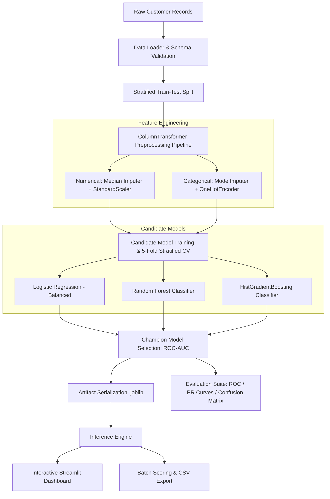

# 🛡️ ChurnGuard AI : Customer Churn Prediction & Retention Analytics Platform

[](https://www.python.org/)
[](https://scikit-learn.org/)
[](https://streamlit.io/)
[]()
[](LICENSE)

An enterprise-ready, end-to-end **Machine Learning Platform** designed to detect customer attrition risk, analyze core behavioral drivers, and empower business retention teams with real-time actionable insights.

---

## 📌 Executive Summary & Business Impact

Customer churn directly impacts company valuation and recurring revenue (ARR/MRR). Acquiring a new customer can cost up to **5x to 7x more** than retaining an existing customer.

**ChurnGuard AI** delivers:
- **High Retention Sensitivity (Recall: 86.35%)**: Captures the overwhelming majority of at-risk customers before they cancel.
- **Calibrated Risk Stratification**: Sorts accounts into *Low*, *Moderate*, and *High Risk* tiers with automated retention strategy recommendations.
- **Zero-Leakage Engineering**: Preprocessing pipelines ensure scalers, encoders, and imputers are strictly fit during CV splits without data leakage.
- **Full-Stack ML Lifecycle**: Complete with synthetic benchmark data generator, multi-algorithm training & cross-validation, unit testing, automated CI/CD, and an interactive Streamlit dashboard.

---

## 🏗️ System Architecture



---

## 📊 Benchmark & Model Comparison

Each candidate classifier was evaluated using 5-Fold Stratified Cross-Validation on the training partition (5,634 samples) and tested on an independent held-out test partition (1,409 samples).

| Model | 5-Fold CV ROC-AUC | Test Accuracy | Test Precision | Test Recall | Test F1-Score | Test ROC-AUC |
| :--- | :---: | :---: | :---: | :---: | :---: | :---: |
| **Logistic Regression (Champion)** | **0.8740 ± 0.0075** | **79.70%** | **46.04%** | **86.35%** | **0.6006** | **0.8828** |
| **Random Forest** | 0.8678 ± 0.0116 | 80.12% | 46.85% | 83.13% | 0.5991 | 0.8765 |
| **HistGradientBoosting** | 0.8554 ± 0.0099 | 81.05% | 48.33% | 79.52% | 0.6013 | 0.8652 |

> **Note on Optimization Choice**: Because missing a churning customer is vastly more costly to revenue than reaching out to an active customer, the pipeline optimizes for **ROC-AUC and Recall** via balanced class weighting.

---

## 🚀 Quickstart Guide

### 1. Clone the Repository
```bash
git clone https://github.com/Itamio-create/customer-churn-ml-platform.git
cd customer-churn-ml-platform
```

### 2. Set Up Virtual Environment & Dependencies
```bash
# Create virtual environment
python -m venv .venv

# Activate on Windows
.venv\Scripts\activate

# Activate on Linux / macOS
source .venv/bin/activate

# Install required packages
pip install -r requirements.txt
```

### 3. Train & Evaluate Models
```bash
python src/train.py
```
This automatically:
1. Generates the realistic 7,043-row benchmark dataset if not present.
2. Trains and cross-validates all candidate models.
3. Selects the champion pipeline and saves it to `models/best_churn_model.joblib`.
4. Saves evaluation metrics to `reports/metrics_summary.json` and diagnostic charts to `reports/figures/`.

### 4. Run Automated Test Suite
```bash
pytest -v
```

### 5. Launch the Streamlit Web Application
```bash
streamlit run app/app.py
```
Navigate to `http://localhost:8501` to use the interactive dashboard:
- **Single Customer Risk Profiler**: Change contract types, monthly charges, or subscribed services to see real-time churn risk updates.
- **Batch Prediction**: Upload a CSV file and download scored risk tiers with 1 click.
- **Model Diagnostics**: Inspect confusion matrix, ROC-AUC curves, and cross-validation comparisons.

---

## 📁 Project Directory Structure

```
customer-churn-ml-platform/
├── .github/
│   └── workflows/
│       └── ci.yml                 # Automated CI/CD test workflow
├── app/
│   └── app.py                     # Interactive Streamlit dashboard
├── data/
│   ├── raw/
│   │   ├── customer_churn.csv     # Benchmark churn dataset
│   │   └── generate_dataset.py    # Realistic synthetic dataset generator
│   └── processed/
├── models/
│   └── best_churn_model.joblib    # Serialized champion pipeline
├── reports/
│   ├── figures/
│   │   ├── confusion_matrix.png   # Confusion matrix visual
│   │   └── roc_pr_curves.png      # ROC and Precision-Recall plots
│   └── metrics_summary.json       # Quantitative performance report
├── src/
│   ├── __init__.py
│   ├── config.py                  # Global path and feature configuration
│   ├── data_loader.py             # Data loading and stratified split
│   ├── evaluate.py                # Diagnostic metrics and plot generation
│   ├── pipeline.py                # Leakage-free Scikit-learn Pipeline
│   ├── predict.py                 # Real-time and batch inference engine
│   └── train.py                   # Multi-model CV and training engine
├── tests/
│   ├── __init__.py
│   ├── test_data.py               # Schema & data loading unit tests
│   ├── test_pipeline.py           # Preprocessor unit tests
│   └── test_predict.py            # Inference engine unit tests
├── .dockerignore
├── .gitignore
├── Dockerfile                     # Production Docker container image
├── requirements.txt               # Pinned Python package dependencies
├── setup.py                       # Package setup definition
└── README.md                      # Comprehensive project documentation
```

---

## 🐳 Docker Deployment

To build and run the platform using Docker:

```bash
# Build Docker image
docker build -t customer-churn-ml:latest .

# Run container
docker run -p 8501:8501 customer-churn-ml:latest
```

Then access the application at `http://localhost:8501`.

---

## 📄 License
This project is licensed under the MIT License - see the [LICENSE](LICENSE) file for details.
